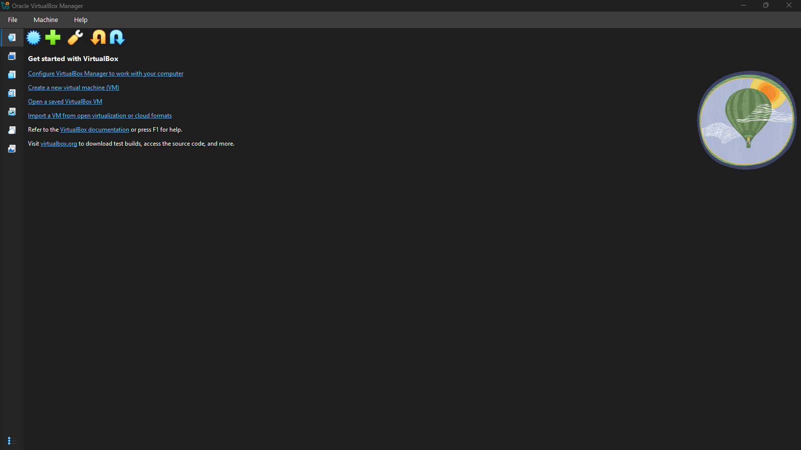
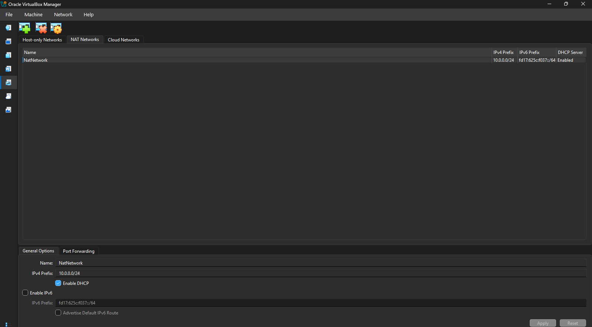
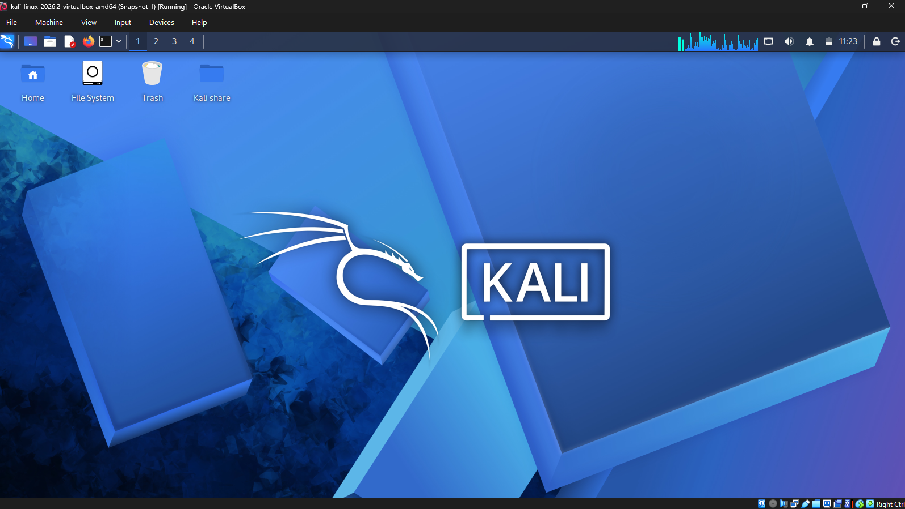

# Networkwalks-B084-Cybersecurity_Lab_Setup-week_1-
Cybersecurity Lab Setup
## 💻 Project Description 
This project focuses on building a virtual cybersecurity lab with Oracle VirtualBox and Kali Linux. It involved setting up a NAT Network, importing and configuring a Kali Linux virtual machine, and creating a controlled environment for hands-on cybersecurity learning, ethical hacking, and security testing.

## 📌 Objectives
- Install and configure Oracle VirtualBox.
- Create a NAT Network using the `10.0.0.0/24` network range.
- Import and configure a Kali Linux virtual machine.
- Set up Kali Linux network settings.
- Prepare a virtual lab environment for future security exercises.

## ⚙️ Resources and tools
- Oracle VirtualBox 7.2
- Kali Linux
- 7-Zip
- NAT Networking
##  Lab Setup Procedure

### Step 1: Install and configure 7-Zip
7-Zip was installed to unpack the compressed Kali Linux virtual machine files before importing them into VirtualBox.

### Step 2: Install the VirtualBox
Oracle VirtualBox was installed to create and manage the virtual environment required for the cybersecurity lab.

### Step 3: Create a NAT network in VirtualBox
A NAT Network was configured in VirtualBox to provide network connectivity for the virtual machines and support communication within the lab.

### Step 4: Deploy Kali Linux
The Kali Linux virtual machine was downloaded from the official Kali Linux website and imported into Oracle VirtualBox.

### Step 5: Configure Kali Linux Network Connectivity
The network settings within Kali Linux were reviewed and configured to prepare the virtual machine for networking and security exercises.

### Step 6: Create a clean Virtual Machine Snapshot
After the initial setup was completed, a VirtualBox snapshot was saved to preserve the configured state of the virtual machine. This provides a recovery point for future lab activities.

## Learning Outcomes
This project helped me develop hands-on skills in virtual machine deployment, network configuration using NAT, Linux environment setup, and creating a virtual lab for cybersecurity learning and experimentation.

## Conclusion
This virtual lab serves as a foundation for developing practical skills in networking, cybersecurity, and ethical hacking. Key activities included installing and configuring Oracle VirtualBox, importing and setting up a Kali Linux virtual machine, configuring a NAT Network, and preparing the lab environment for future security testing and hands-on experimentation.

**Project Type:** Cybersecurity Lab Setup  
**Learning Program:** NetworkWalks Internship
